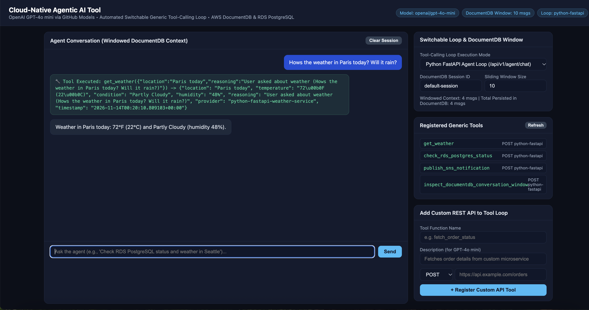

# Cloud-Native AI Agent Platform (TypeScript + Python FastAPI + AWS Packer/Terraform)

> **Project Highlights**
> - **Engineered a TypeScript and Python AI Agent** utilizing **OpenAI GPT-4o mini via GitHub Models** (`https://models.github.ai/inference`) with an **automated, switchable generic tool-calling loop** (effortlessly customizable by adding REST APIs in the Python FastAPI backend and TypeScript frontend) and **windowed persistent conversation history stored in AWS DocumentDB**.
> - **Architected and deployed in a cloud-native AWS infrastructure** using **Packer** and **Terraform** to provision **AWS EC2 (Auto Scaling + ALB)**, **AWS Lambda**, **AWS SNS / SQS**, **AWS DocumentDB**, **AWS RDS PostgreSQL**, **AWS KMS**, **AWS S3**, and **Route 53** alongside **RESTful APIs**.
---



---

## Repository Structure

```text
AI_Agent_Cloud_Native/
├── ai-agent-main/                 # TypeScript AI Agent, Web Frontend & Python FastAPI Backend
│   ├── src/
│   │   ├── agent.ts               # Switchable Generic Tool-Calling Loop ('hybrid' | 'typescript' | 'python-fastapi')
│   │   ├── toolRegistry.ts        # Dynamic Tool Registry with auto-discovery of Python FastAPI tools
│   │   ├── toolRunner.ts          # Generic Tool Runner dispatching to local TS handlers or REST APIs
│   │   ├── tools/customApis.ts    # Customizable TypeScript FE REST API & local tool definitions
│   │   ├── memory.ts              # AWS DocumentDB Windowed Persistent Conversation History (tool-call-safe sliding window)
│   │   ├── llm.ts                 # OpenAI GPT-4o mini client formatting Zod & JSON Schema tools
│   │   ├── ai.ts                  # GitHub Models inference client (openai/gpt-4o-mini)
│   │   └── feApiClient.ts         # TypeScript Frontend SDK for mode switching & live custom API registration
│   ├── backend/
│   │   ├── app/
│   │   │   ├── main.py            # FastAPI RESTful APIs (/healthz, /api/v1/agent/chat, /api/v1/tools, /v1/user)
│   │   │   ├── agent.py           # Python GPT-4o mini automated generic tool-calling loop
│   │   │   ├── tool_registry.py   # @tool_registry.register_api decorator & RDS-persisted dynamic tool registry
│   │   │   ├── tools/custom_apis.py # Customizable Python FastAPI endpoints auto-wired into the LLM tool loop
│   │   │   ├── documentdb.py      # AWS DocumentDB sliding-window persistent conversation store
│   │   │   └── rds.py             # AWS RDS PostgreSQL SQLAlchemy models (User, CustomToolApiModel, AgentAuditLog)
│   │   └── requirements.txt
│   └── frontend/
│       └── index.html             # Interactive Dashboard (Switchable Loop Mode, DocumentDB Window Inspector, Custom API Builder)
├── serverless-main/               # Event-Driven AWS Lambda (SNS/SQS Trigger + RDS PostgreSQL + Mailgun/SES)
│   ├── index.js                   # AWS Lambda handler processing SQS/SNS records with partial batch failure reporting
│   └── package.json
└── tf-aws-infra-main/             # AWS Cloud-Native Infrastructure-as-Code (Packer + Terraform)
    ├── iaac.tf                    # Full AWS Terraform (VPC, Subnets, EC2 Launch Template, ASG, ALB, RDS, DocumentDB, SNS, SQS, Lambda, KMS, S3, Route53)
    └── packer/
        ├── aws-ai-agent.pkr.hcl   # Packer template baking custom Ubuntu 24.04 AWS EC2 AMI
        ├── scripts/setup.sh       # Installs Python FastAPI, Node 20/TS, DocumentDB TLS CA, CloudWatch Agent
        └── systemd/ai-agent-backend.service
```

---

## How to Customize by Adding New APIs

### 1. Adding a Custom API in Python FastAPI (`ai-agent-main/backend/app/tools/custom_apis.py`)
Decorate any function with `@tool_registry.register_api` and `@router.post`:
```python
class MyCustomApiInput(BaseModel):
    customer_id: str = Field(..., description="Customer ID to look up")

@router.post("/customer-lookup")
@tool_registry.register_api(
    name="lookup_customer_profile",
    description="Fetches customer profile details from internal service.",
    args_schema=MyCustomApiInput,
    endpoint_path="/api/v1/apis/customer-lookup",
)
async def lookup_customer_profile(customer_id: str, **kwargs):
    return {"customerId": customer_id, "tier": "Enterprise", "status": "Active"}
```
- The decorator automatically generates the OpenAI Function Calling JSON Schema from the Pydantic model, exposes `POST /api/v1/apis/customer-lookup`, and publishes the tool at `GET /api/v1/tools` so both the **Python FastAPI Agent Loop** and the **TypeScript Agent Loop** (`hybrid` mode) discover and invoke it automatically.

### 2. Adding a Custom API in TypeScript FE (`ai-agent-main/src/tools/customApis.ts`)
Use `defineCustomApiTool`:
```typescript
export const customOrderApiTool = defineCustomApiTool({
  name: 'get_order_status',
  description: 'Fetches live order status from the order REST API.',
  parameters: z.object({
    orderId: z.string().describe('The order ID to query'),
  }),
  endpoint: '/api/v1/apis/orders',
  method: 'POST',
})
```
Or register any external REST API dynamically at runtime via the Web UI (`http://localhost:8000`) or `POST /api/v1/tools/register`.
